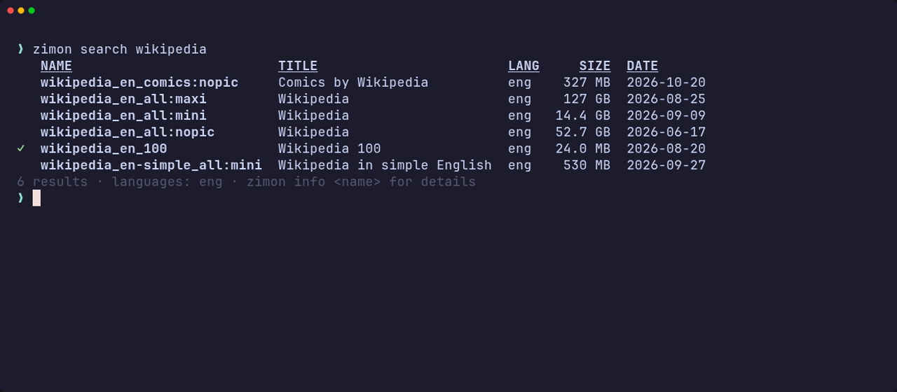
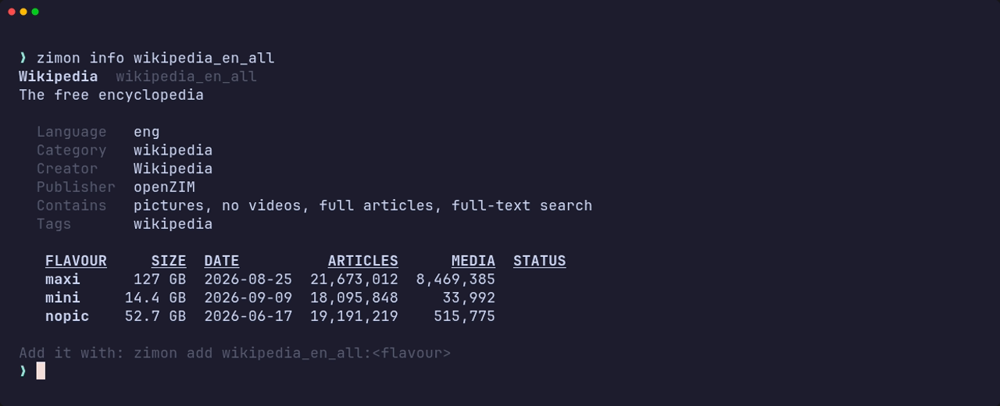
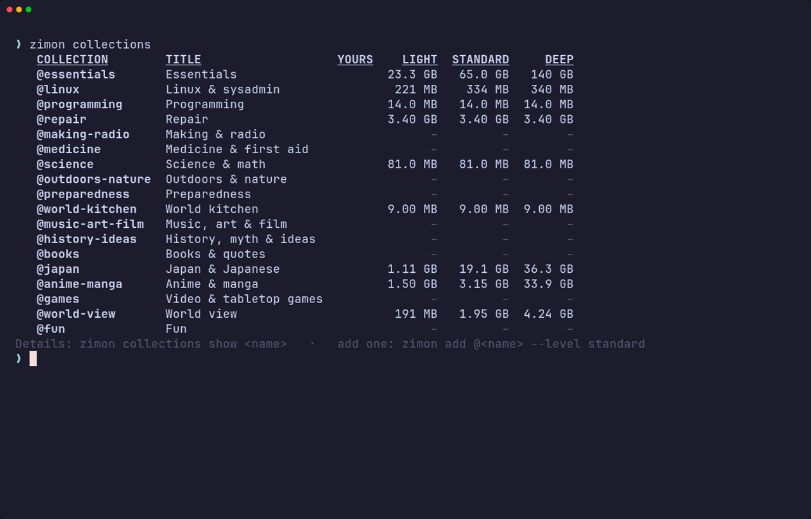
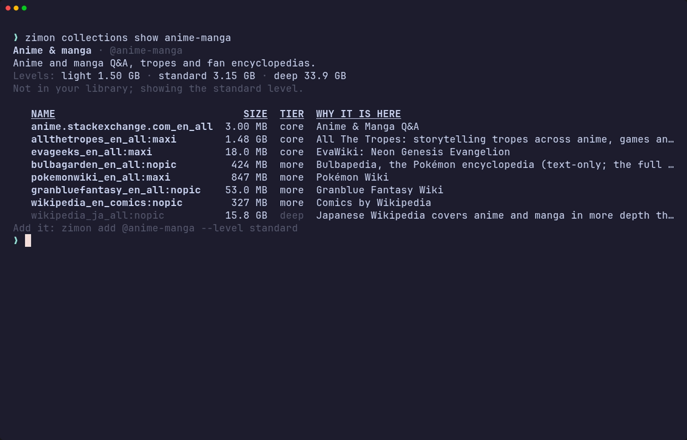
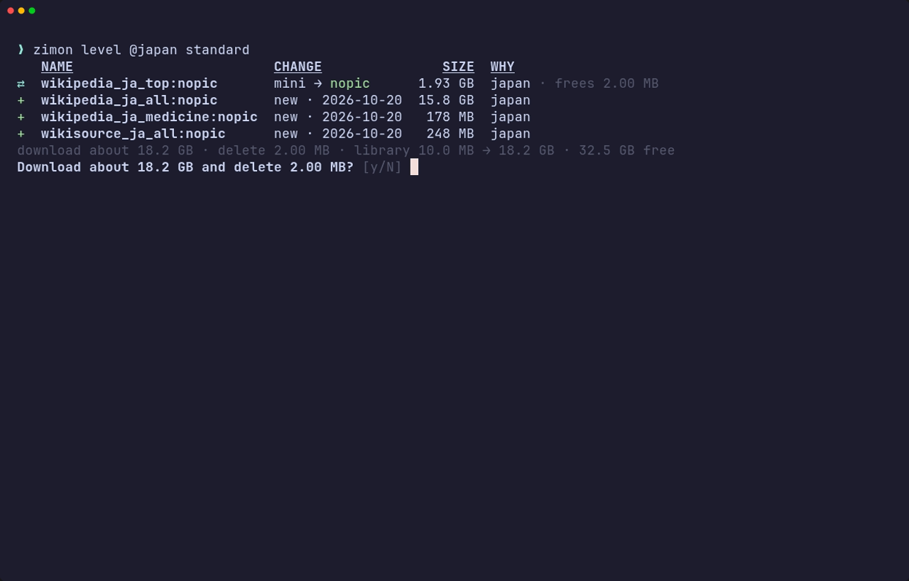
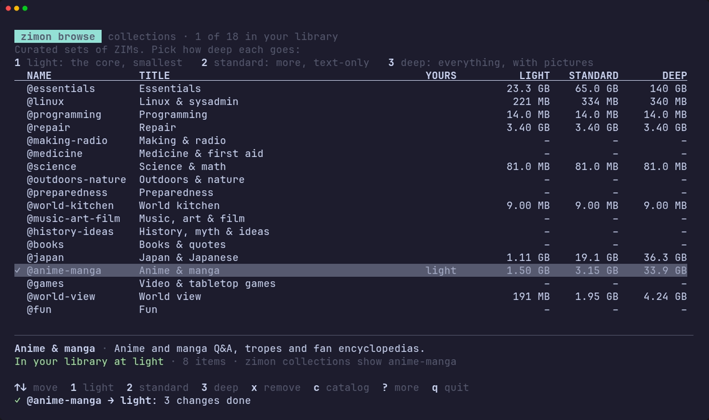
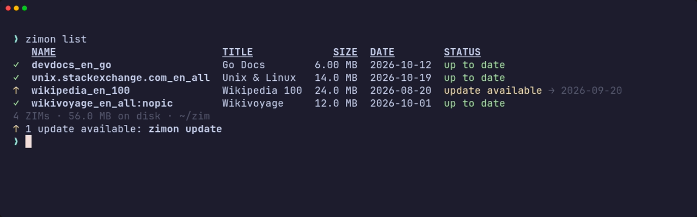
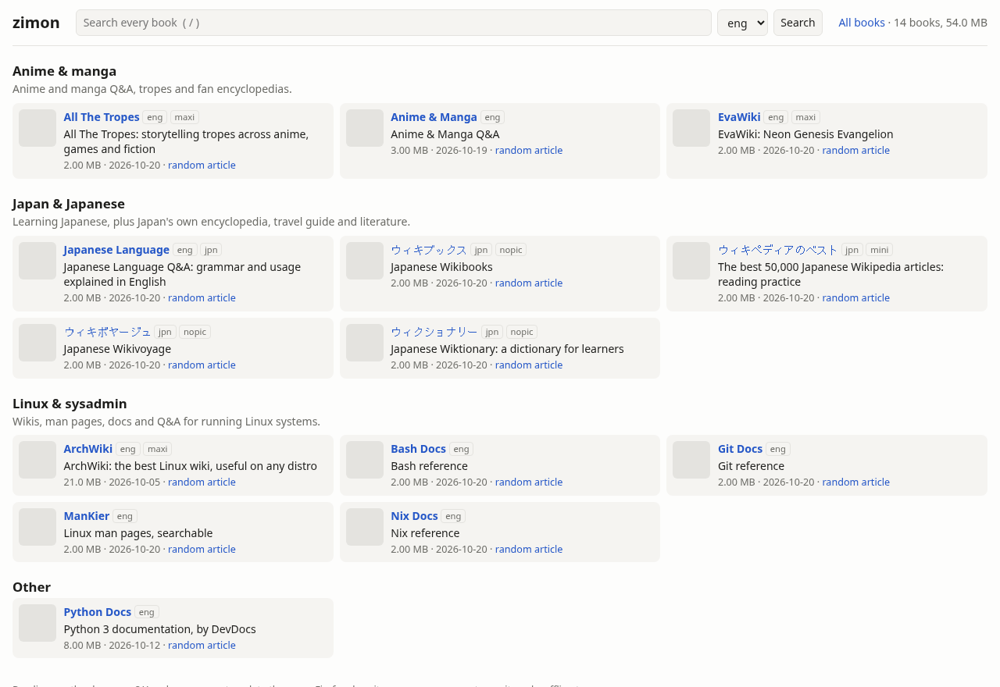
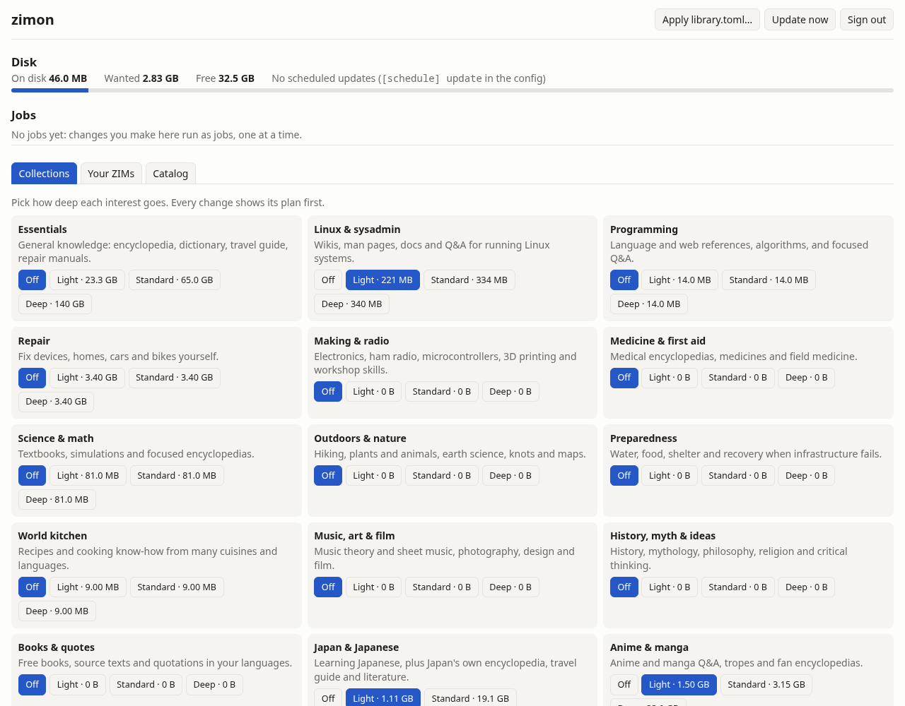
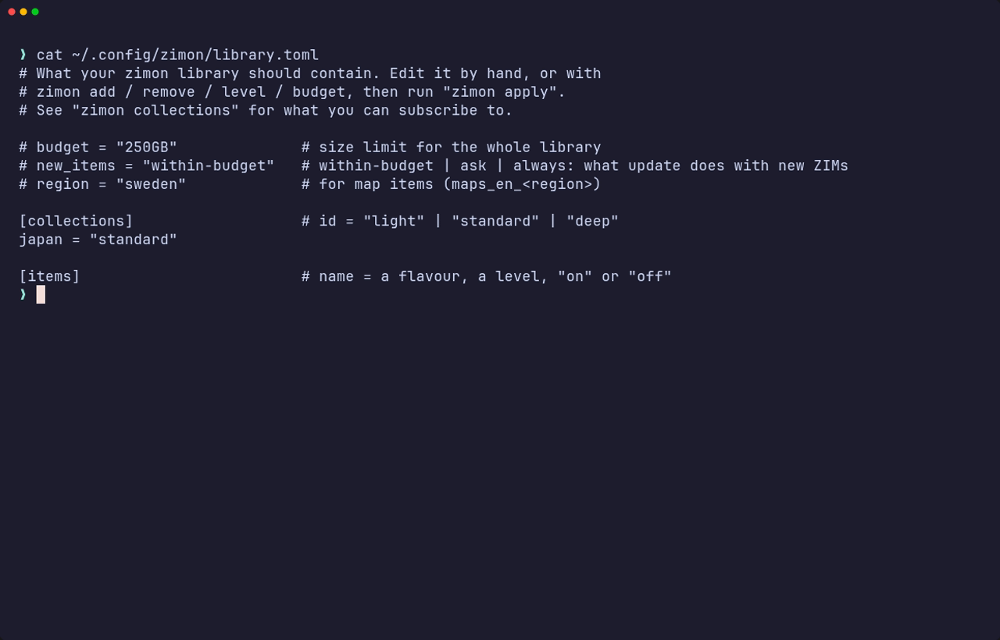

# zimon

**A friendly manager for [Kiwix](https://kiwix.org) ZIM files**: offline copies of
Wikipedia, Stack Exchange, Project Gutenberg, DevDocs and thousands more.

zimon finds ZIMs in the Kiwix catalog, downloads them from the nearest mirror
(resuming if interrupted), checks every byte against Kiwix's published
checksums, keeps them up to date, and serves them in your browser through
`kiwix-serve`. It works the same on a laptop and on a headless NAS.

Not sure what to get? Curated **collections** (Linux, repair, medicine,
science, Japan, anime & manga, games, world view, ...) come in three depths,
and everything you choose lives in one small `library.toml` you can keep in git.


## Install

With Go 1.26 or newer:

```sh
go install github.com/kazie/zimon@latest
```

Or grab a binary for Linux (amd64/arm64) or macOS from the
[releases page](https://github.com/kazie/zimon/releases). It is a single static
file with no dependencies; the archive also has shell completions and a man page.

macOS support is in beta: the binaries are built for it, but nobody has tried
them on a Mac yet (nor the kiwix-serve that `zimon serve` fetches there).
Reports are welcome.

With Nix: `nix run github:kazie/zimon -- search wikipedia`, or add the flake's
`packages.default` to your system (with completions and `man zimon`).

Books open in `kiwix-serve` from [kiwix-tools](https://github.com/kiwix/kiwix-tools).
You don't need to install it: when there's none on your `PATH`, `zimon serve`
fetches Kiwix's own build (10–21 MB) once, in the background (the start page
works meanwhile, and it tries again if the network is down), checks it against
the SHA-256 that this zimon release pins, and keeps it in the state folder.
Your distro's `kiwix-tools` package, or `serve.kiwix_serve_path`, takes
precedence. When a newer zimon pins a newer kiwix-serve, `zimon serve` deletes
the old copy as it starts.

## Quick start

```sh
zimon collections                 # curated sets and their sizes
zimon add @linux @repair          # add some (it asks how deep: light, standard, deep)
zimon add wikipedia_en_all:nopic  # or pick single ZIMs (Ctrl-C is safe; it resumes)
zimon serve                       # read it at http://localhost:8080
zimon update                      # later: fetch newer releases
```

The first run asks where to keep ZIM files (default `~/.local/share/zimon/library`)
and which languages you care about (default: your system language plus English),
in a short form where you tick languages from a list. `zimon init` asks again.

## Tour

### Find: `search`, `info`, `browse`

`zimon search` looks through titles, descriptions, names and tags. It shows your
languages by default; use `--all-langs` or `--lang swe,fra` for others, and
`--category` or `--max-size` to narrow it down.



`zimon info <name>` shows what a ZIM contains and how big each **flavour** is:
`maxi` (everything), `nopic` (no pictures) and `mini` (intros only).



`zimon browse` is an interactive browser for the whole catalog. Filter as you
type, flip through categories with <kbd>tab</kbd>, press <kbd>a</kbd> to
download in the background while you keep browsing. <kbd>?</kbd> shows every
key.


### Collections: `collections`, `add @…`, `level`

Collections are curated sets of ZIMs worth having offline: Wikipedia and a
dictionary, Linux wikis and man pages, repair guides, medicine, science
textbooks, preparedness, Japan, anime & manga, games, music, history, a
"world view" of other languages' Wikipedias, and more. Each one comes in three
depths:

| Level | What you get |
|---|---|
| **light** | the core items, in their smallest versions |
| **standard** | core and more, text-only where there is a choice |
| **deep** | everything except the giants, with pictures |

Giants (all of Stack Overflow at 115 GB, Khan Academy's 180 GB of video, all
of Project Gutenberg, ...) are never added by a level: they carry an honest
note and you add one on purpose with `zimon level <name> on`.



`zimon collections show <name>` lists what is in a collection, tier by tier,
with a note on why each ZIM is worth having:



`zimon add @japan` asks how deep to go, showing the size of each level.
`zimon level @japan standard` raises (or lowers) it later and shows exactly
what that downloads and deletes first:



Every collection uses your languages: with `languages = ["eng", "swe", "jpn"]`
the essentials include the English, Swedish and Japanese Wikipedias. A single
ZIM can go its own way: `zimon level wikipedia_en_all maxi` for the full
English Wikipedia with pictures, or `zimon level minecraft.wiki_en_all off`
to leave one out. Switching flavours downloads and verifies the new one before
the old one is deleted.

In `zimon browse`, press <kbd>c</kbd> for the collections and
<kbd>1</kbd>/<kbd>2</kbd>/<kbd>3</kbd> to set a level:



Your own collections go in `collections.toml` next to `library.toml`, in the
same format as [the built-in ones](internal/collections/builtin.toml).

### Download: `add`

`zimon add` adds a ZIM to `library.toml` and downloads it. If you leave out the
flavour, it asks.


Downloads are careful:

- Mirrors come from Kiwix's `.meta4` files, nearest first. A mirror that fails
  or sends bad data is skipped.
- Each 4 MiB piece is checked against its SHA-1 as it arrives, and the whole file
  against its SHA-256 before it is used.
- Progress is saved as you go. Ctrl-C, a dropped connection or a reboot just
  means the next run continues where it stopped.
- zimon checks free disk space first and refuses to start a download that won't fit.

### Stay current: `list`, `update`, `verify`, `prune`



`zimon update` refreshes the catalog and downloads newer releases of
everything in `library.toml`. A new release replaces the old file only after
it has been verified, and the old one is deleted afterwards (set
`keep_versions` to keep more).


- `zimon update --check` shows what is new without downloading.
- When a collection gains a ZIM (or an earlier download never finished),
  `update` fetches it only while the library stays within your budget; see
  `new_items` below. It never deletes anything or switches flavours: that is
  `zimon apply`'s job.
- `zimon verify` re-reads your files and checks them against their SHA-256.
- `zimon prune` cleans up old versions and abandoned partial downloads.
- `zimon doctor` checks everything at once: config.toml and library.toml, the
  folders, the free space against the budget, the database, the library folder
  against the database (and library.xml), leftovers for prune, the catalog's
  age, kiwix-serve, who holds the lock, and whether the remotes answer. It says
  how to fix what it finds, and exits 1 on a problem, so it also suits a
  monitoring script. It works even when a config file has a mistake.
- `zimon remove <name>` (or `@collection`) takes it out of `library.toml` and
  deletes the files. A ZIM another collection still wants stays.
- `zimon hold <name>` keeps the release you have: `update` and `apply` skip
  its newer releases and flavour changes, and `zimon list` shows it as held.
  `zimon hold` lists what is held; `zimon unhold <name>` lets it update again.

If Kiwix drops a ZIM from its catalog, zimon keeps your copy and marks it
"gone upstream" in `zimon list`.

### Read: `serve`

`zimon serve` opens a start page with every book on disk, grouped by your
collections with their notes, and one search box across all of them (press
`/` to jump to it). Books open in `kiwix-serve`, which zimon runs behind the
scenes and starts again if it stops (the first time, zimon fetches it from
Kiwix if it isn't installed; see [Install](#install)). `/library` is kiwix-serve's own book list.



Every `add`, `update` and `remove` rewrites the `library.xml` that
kiwix-serve reads, and it picks up the change by itself, so you never need to
restart anything. Book URLs leave out the release date
(`/content/wikipedia_en_all_nopic/`), so bookmarks keep working after updates.
Book icons come from the Kiwix catalog the first time the page shows them and
are kept, so the page works offline afterwards. The footer, here and on the
admin page, says which zimon serves it: its version and commit, linked to
the release notes and the commit on GitHub (`zimon --version` says the same).

```sh
zimon serve                    # http://127.0.0.1:8080, this computer only
zimon serve --address all      # share it on your network
zimon serve --plain            # just kiwix-serve, without the start page
zimon serve --print            # show the kiwix-serve command --plain runs
```

Only this computer can reach it unless you ask for more: `--address all`, or
`serve.address = "all"` in the config to make that the default. Reading is
open to anyone who can reach it; nothing in the library can be changed from the
browser. `GET /api/v1/status` answers `{"ok":true,…}` for health checks.

#### The admin page

The admin page manages the library from a browser. It has its own port, the
next one up (http://127.0.0.1:8081/admin by default; `--admin-port` or
`serve.admin_port` to change it), so a script inside a book can never reach it.
If that port is taken, `zimon serve` says so and serves the books without it.
The admin page shows disk use against your budget and the live progress of
every change, above three tabs:
- Collections: a Light / Standard / Deep switch per collection, with the size
  of each;
- Your ZIMs: flavour changes and removal;
- Catalog: the whole Kiwix catalog, filtered as you type.

A new library has no catalog yet; `zimon serve` fetches it when it starts
(the page says so meanwhile) and tries again later if that fails.

Each change shows its plan first, as `zimon apply` does, and runs only if the
plan is still the one you saw. Whatever you change is written to
`library.toml`, the same as with the commands.



When only this computer can reach the server, `zimon serve` prints a sign-in
link that works once (in a terminal, not into a service's log). Otherwise
sign in with a token from `zimon token add`. A sign-in lasts 30 days (a
one-time link's, a day), also across restarts and updates. The session cookie is HttpOnly and
SameSite=Strict, and Secure behind an HTTPS proxy. Removing the token with
`zimon token remove` ends its sessions. Wrong tokens, on the page or the API,
are limited to 5 per address every 10 minutes.

When a reverse proxy already checks who is asking (nginx with basic auth, or
single sign-on), it can sign them in itself: it sends a token in the
`X-Zimon-Admin-Token` header with every request to the admin page's host,
and the page asks for none. Make a token for it (`zimon token add proxy`);
removing that token ends this too. Only the admin port reads the header,
changes must still come from the admin page, and signing out happens at the
proxy.

#### The API and tokens

`zimon serve` also has a JSON API under `/api/v1`, on both ports, for scripts
and for managing a server from elsewhere. Everything but the status needs a
token:

```sh
zimon token add laptop      # shown once; zimon keeps only a hash
zimon token list
zimon token remove laptop   # that token stops working at once
curl -H "Authorization: Bearer $TOKEN" http://localhost:8080/api/v1/items
```

| Endpoint | What it gives |
|---|---|
| `GET /api/v1/status` | the health check, and the API version (no token needed) |
| `GET /api/v1/info` | the server's zimon and library: version and commit, paths, languages, catalog |
| `GET /api/v1/items` | everything in the library, as `zimon list --json` |
| `GET /api/v1/collections` | collections, your levels and the size of each level |
| `GET /api/v1/collections/ID` | what a collection holds, as `zimon collections show` |
| `GET /api/v1/search?q=…&lang=eng` | the catalog (also `category`, `flavour`, `max_size`, `limit`, or `prefix` for names; `X-Total-Count` says how many match) |
| `GET /api/v1/entries/NAME` | every flavour of a ZIM (a 404 suggests `similar` names) |
| `GET /api/v1/categories`, `GET /api/v1/languages` | the catalog's categories and languages, with how many ZIMs each has |
| `GET /api/v1/budget` | use per collection, the budget and free space |
| `GET /api/v1/plan` | what `zimon apply` would do now |
| `GET /api/v1/prune` | what `prune` would delete; send some of the paths back as `{"paths": […]}` to delete only those |
| `GET /api/v1/suggest?c=linux&c=games&budget=…` | levels for collections that fit a budget (default: the one in `library.toml`), as `zimon suggest` |
| `GET /api/v1/files/UUID` | a ZIM file (resumable), with its sha-256 in `X-Zimon-Sha256` |
| `POST /api/v1/add` | `{"keys": ["wikipedia_en_all:nopic"], "collections": {"linux": "deep"}}`; `"sources": [{"from": "https://…/x.zim", "name": "…", "sha256": "…"}]` adds ZIMs from URLs; `"no_download": true` only edits `library.toml` |
| `POST /api/v1/level` | `{"target": "@linux", "choice": "light"}`, or a ZIM name and a flavour, `on`, `off` |
| `POST /api/v1/remove` | `{"targets": ["@games", "minecraft.wiki_en_all"], "keep_files": false}` |
| `POST /api/v1/apply`, `update`, `prune`, `verify`, `refresh` | as the commands of the same name; `update` and `verify` take `{"names": […]}` |
| `POST /api/v1/budget` | `{"budget": 250000000000}` sets the budget in bytes (`0` for none) |
| `POST /api/v1/hold`, `unhold` | `{"names": ["wikipedia_en_all"]}` holds ZIMs at the release on disk, or lets them update again |
| `GET /api/v1/schedule` | how often `update` runs by itself, and when next |
| `GET /api/v1/jobs`, `GET /api/v1/jobs/ID` | what changes ran, how they went, and their log |
| `POST /api/v1/jobs/ID/cancel` | stop a queued or running job |
| `GET /api/v1/events` | live job progress, as Server-Sent Events: `progress`, `step` (how each step went), `log` lines and more |

Keys are `name:flavour`, with `name:` for the version without a flavour; a
bare name works for a ZIM that comes in one flavour, and in `remove` means
every flavour you have. Changes run as jobs, one at a time and under the same lock as the commands,
so they never collide with a timer-driven update. A change answers `202` with
its job; add `?preview=1` to `add`, `level`, `remove`, `apply` or `update`
to get the plan instead, without changing anything. Send the plan's `id` back as `"plan"` with
the change (or with `apply`, from `GET /api/v1/plan`) and the job fails rather
than do something else if the library changed in between. Jobs a stopped server left behind are
marked interrupted; downloads resume on the next try. `zimon jobs` lists them
(`zimon jobs ID` shows one with its log), on the server or with `--remote`.

### Your library in a file: `library.toml` and `apply`

Everything you choose is written to `library.toml` (next to `config.toml`),
so your whole library is one small file you can read, edit, keep in git and
copy to a new machine:



```toml
budget = "250GB"

[collections]
linux       = "deep"
japan       = "standard"
anime-manga = "standard"

[items]
"wikipedia_en_all"      = "nopic"   # a flavour, a level, "on" or "off"
"minecraft.wiki_en_all" = "off"

[hold]                              # zimon hold: keep the release on disk
"wikipedia_en_all"      = "2026-01-15"
```

`zimon apply` makes the disk match the file, after showing the plan. Commands
like `add`, `level` and `remove` edit the file for you and keep your comments.
They edit it one line at a time, so keep one `key = "value"` per line, as
above. zimon still reads other valid TOML (dotted keys, inline tables), but it
won't edit such a file and tells you which line to rewrite.

- **Recovery:** with only `library.toml`, `zimon apply` rebuilds the library.
  ZIMs already in the library folder are checked against their SHA-256 and
  kept instead of downloaded again, so a lost database costs a re-check, not a
  re-download.
- **Budgets:** `zimon budget 250GB` sets one, `zimon budget` shows the use per
  collection. `zimon suggest --budget 250GB @linux @japan @games` starts your
  collections light and deepens them in the order you list them while
  everything still fits.

### Bring your own ZIM

Not everything is in the Kiwix catalog. zimon keeps ZIMs from elsewhere too:
one you built with [zimit](https://github.com/openzim/zimit) or
[mwoffliner](https://github.com/openzim/mwoffliner), or one a site publishes.

```sh
zimon add ~/zims/mysite_en_all_2026-11.zim
zimon add https://example.org/zims/notes_en_all.zim --sha256 9f86d081…
```

- A file is cloned into the library folder where the disk can (btrfs, XFS: no
  extra space until one of them changes), else copied, so rebuilding it in
  place never touches the library's copy. A file already in the library folder
  stays where it is and becomes the library's own: `zimon remove` deletes it.
  It is named after the ZIM's own name (its `Name` metadata), or its file
  name; `--name` picks another. A symbolic link adds the file it points to.
- A URL is downloaded like any ZIM: it resumes, and zimon checks the free space
  first. It is named after its file name. No Kiwix checksum covers it;
  `--sha256` does, for that release.
- `library.toml` keeps where each one comes from, in `[sources]`:

  ```toml
  [items]
  "mysite_en_all" = "on"
  "notes_en_all"  = "on"

  [sources]
  "mysite_en_all" = "/home/me/zims/mysite_en_all_2026-11.zim"
  "notes_en_all"  = "https://example.org/zims/notes_en_all.zim"
  ```

- `zimon update` (and `zimon refresh`) looks there for a new release: for a
  URL, a ranged request for the file's first bytes, conditional on its `ETag`
  and `Last-Modified`, so an unchanged file costs next to nothing; for a file,
  its size and time. A new build at the same URL or path is an update like any
  other, and `zimon hold` keeps the one you have. Other changes (`apply`,
  `add`) look only at sources not seen yet, such as one you added to
  `library.toml` by hand.
- On a remote (`--remote`), add from a URL: the server downloads it. A file can
  only be added on the machine it is on.
- A ZIM from the Kiwix catalog is added by its name instead. If you already
  have the catalog's latest release, put it in the library folder under its
  catalog file name and `zimon add` it by name: zimon checks it against Kiwix's
  SHA-256 and keeps it instead of downloading it.

**More catalogs:** `catalogs = ["https://library.example.org/catalog/v2"]` in
`config.toml` adds other OPDS catalogs, another kiwix-serve's say. Their ZIMs
are found, added and updated like Kiwix's. When two catalogs have the same
ZIM, the newest release wins (the first catalog on a tie). One that can't be
reached keeps what zimon had from it; Kiwix's catalog must answer. A catalog
that links the ZIM file itself rather than a `.meta4` is downloaded without
checksums.

#### Getting a site into the Kiwix catalog

A ZIM's best home is the Kiwix catalog: everyone can get it, it is rebuilt as
the site changes, and zimon updates it with checksums. Anyone can ask for one
at [openzim/zim-requests](https://github.com/openzim/zim-requests):

1. Look first: `zimon search <words>`, and the
   [open requests](https://github.com/openzim/zim-requests/issues).
2. Open an issue with the request template: the site's address, its language,
   and why it is worth having offline. The openZIM team tries it with zimit
   (any website) or mwoffliner (MediaWiki wikis) and, when the result is good,
   publishes it to the catalog.
3. Meanwhile, or for a site you can't share, build it yourself with zimit and
   `zimon add` the file. See zimit's README for its options.

A worked example: [Japari Library](https://japari-library.com/), the English
fan wiki of *Kemono Friends*. The site sits behind a bot challenge, so a
crawler gets the challenge page, not the wiki. Never try to get around one:
no faking a browser, no solving the challenge. Ask instead, and say so in the
request, so the openZIM team can talk to the wiki's admins about letting the
crawler in or using a dump:

> **Japari Library (Kemono Friends wiki)**
> URL: https://japari-library.com/ · Language: English
> Why: the English fan wiki of Kemono Friends, worth having offline.
> Note: the site is behind a bot challenge, so a plain crawl gets the challenge
> page. Could you ask its admins to allow the crawler, or work from a dump?

When it is published, `zimon search japari` finds it and `zimon add` takes it
from there. (A link to such a challenge page is not a ZIM: `zimon add` says
so and stops.)

## On a NAS or server

zimon was built to run unattended:

- `zimon update --yes` never asks questions. Without a terminal, progress is one
  log line per 10%, which suits `journalctl`.
- A lock file stops a timer-driven update and an interactive `zimon add` from
  stepping on each other. The second one waits.
- `zimon serve` stops cleanly on SIGTERM and takes kiwix-serve with it, even if
  zimon itself is killed. `zimon serve --plain` replaces itself with
  `kiwix-serve` instead.
- Downloads can be rate-limited (`download.rate_limit = "20MB"` per second).
- A `budget` in `library.toml` keeps unattended updates from filling the disk
  when collections grow.
- What the server holds is one file, `/etc/zimon/library.toml` next to the
  config below: keep it in git, and `zimon apply` rebuilds the server from it.

Ready-made systemd units (a weekly update timer and a serve service, as user or
system units) live in [`contrib/systemd`](contrib/systemd/README.md). Instead
of the timer, `zimon serve` can update on its own schedule:
`[schedule] update = "weekly"` in the config. Its runs show up in the admin
page's job list like any other change. A run that fails, Kiwix being down
say, is tried again an hour later.

A typical server config (`/etc/zimon/config.toml`, selected with `ZIMON_CONFIG`):

```toml
library_dir = "/srv/zim"
state_dir = "/var/lib/zimon"
languages = ["eng", "swe"]
keep_versions = 1

[download]
rate_limit = "20MB"

[serve]
address = "all"   # serve the whole network; the default is this machine only
port = 8080
```

### Behind a reverse proxy

For HTTPS on a public host, leave `serve.address` at its default
(`127.0.0.1`), so zimon is not reachable from outside, and let your web server
forward to it. kiwix-serve itself only ever listens on a private port. Give
the admin page its own host name, so books and the admin page never share an
origin. For nginx, [`contrib/nginx/zimon.conf`](contrib/nginx/zimon.conf) is
ready to use. zimon tells a request that came through the proxy (by its
`X-Forwarded-*` headers) apart from a direct one: `/admin` on the books' host
then says the admin page has a host name of its own, instead of linking to
the admin port.

When the proxy asks for a password before the admin page, it can also save
you zimon's sign-in by passing a token
([the admin page](#the-admin-page)). In nginx it is one more
`proxy_set_header` beside the others for the admin host (see the comments in
`contrib/nginx/zimon.conf`):

```nginx
include /etc/nginx/zimon-admin-token.conf;   # proxy_set_header X-Zimon-Admin-Token "zimon_…";
```

Keep it in a file of its own that only root and nginx may read, since anyone
with the token can change the library, and never pass it on the books' host.

### From your laptop: `--remote`

Manage the server's library without logging in to it. Add it as a remote
once, then any command runs there with `--remote NAME`, or for a whole shell
session with `ZIMON_REMOTE=NAME`:

```sh
zimon remote add nas ssh://you@nas.local    # ssh://[user@]host[:port]
zimon remote test nas                       # does zimon answer there?
zimon --remote nas add @linux               # downloads on the NAS
set -x ZIMON_REMOTE nas                     # fish; bash: export ZIMON_REMOTE=nas
zimon browse                                # the NAS's library, interactively
```

It is plain ssh underneath: zimon runs `ssh nas -- zimon <command>` (with
`-t` at a terminal), so prompts, progress bars, `browse`, Ctrl-C and exit codes
all work as if you were logged in, and shell completion asks the server. Set up
ssh keys and `~/.ssh/config` as for any server. When zimon is not simply
`zimon` on the server's `PATH`, say how to run it:

```sh
zimon remote add nas ssh://nas --command "sudo -u zimon zimon"
zimon remote add box ssh://box --command "podman exec -i zimon zimon"
```

Remotes live in `remotes.toml` next to `config.toml` (readable by you only).
`zimon remote list` and `zimon remote remove NAME` manage them; managing
remotes, `pull`, `completion`, `help` and `man` always run locally, and so does a command
given an empty `--remote=`.

`remote.ssh_command` in the config is split on spaces, so put anything more
involved (jump hosts, proxies) in `~/.ssh/config`. Shell completion opens an ssh
connection per Tab; ssh's connection sharing (`ControlMaster auto` with a
`ControlPersist` for the host) makes that instant.

#### Over HTTPS, with a token

When `zimon serve` runs behind an HTTPS proxy (or ssh is not an option), add
it by its address instead. `add` asks for a token, made on the server with
`zimon token add`, checks that the server takes it, and keeps it in
`remotes.toml`:

```sh
zimon remote add home https://zim-admin.example.org   # asks for the token
zimon --remote home list                               # the server's library
zimon --remote home jobs                               # what it did lately
```

The command runs on your computer and asks the server's API, so there is
nothing to install there but `zimon serve`. A change (`add`, `update`, `apply`,
`remove`, `level`, `prune`, …) shows its plan, asks, and then runs on the
server as a job, with its progress shown here as if it ran here. Ctrl-C stops
showing it, but the job carries on: `zimon jobs ID --follow` shows it again,
`zimon jobs ID --cancel` stops it. `browse` works the same way (its
downloads are jobs there too, and carry on when you quit), and so does shell
completion. Only `serve`, `init`, `config` and `token` are for the server
itself: run them there, or through an `ssh://` remote. Plain `http://` works too, with a warning when the
server is another machine: the token would cross the network unencrypted.

#### Take it with you: `pull`

`zimon pull` copies ZIMs from the server's library into the one on your
laptop, over the home network rather than from Kiwix:

```sh
zimon pull home @linux                     # at your level, else the server's
zimon pull home @programming --level light # or at another level
zimon pull home wikipedia_en_all:maxi
```

It adds them to your `library.toml`, as `zimon add` does, so they stay in your
library and `zimon update` keeps them current. The files come from the server
only (its API serves them, with resuming). Each is checked against Kiwix's
`.meta4` (its sha-256 and piece hashes) when it is the release in your catalog
and Kiwix can be reached; otherwise against the sha-256 the server has for it,
which the server checked against Kiwix's when it downloaded the file. You get
the release the server has, when you have none or an older one. What the server lacks, or has only in an older release, stays in
`library.toml` for `zimon apply` to download from Kiwix. Ctrl-C is safe: run
the same pull again to resume. A pull that would make `library.toml` drop
something (a lower `--level`, another flavour than yours) asks first, as
`zimon apply` then deletes it. `pull` needs an `https://` (or `http://`)
remote; an `ssh://` one has no API to download from.

## Your own local internet server

The container image runs zimon's start page with kiwix-serve behind it, and
keeps everything (config, `library.toml`, the ZIMs, the database) in one
volume at `/data`. It runs as an ordinary user, and comes for amd64 and arm64
(a Raspberry Pi 4 or 5 with a 64-bit OS will do).

### With Podman (Quadlet)

[`contrib/podman/zimon.container`](contrib/podman/zimon.container) lets systemd
run it, restart it and keep it up to date, without root:

```sh
mkdir -p ~/.config/containers/systemd
cp contrib/podman/zimon.container ~/.config/containers/systemd/
systemctl --user daemon-reload
systemctl --user start zimon
loginctl enable-linger $USER          # keep running after you log out
```

Open <http://localhost:8080> and fill the library:

```sh
podman exec zimon zimon collections
podman exec zimon zimon add @linux @repair --level standard
podman exec -it zimon zimon browse
```

Or manage it from your laptop over ssh (see [`--remote`](#from-your-laptop---remote)):

```sh
zimon remote add home ssh://you@server --command "podman exec -it zimon zimon"
zimon --remote home add @medicine
```

(`-it` gives zimon a terminal in the container, for prompts, progress bars and
browse; for scripts and timers, `-i` is enough.)

The [admin page](#the-admin-page) is on the second published port,
<http://localhost:8081/admin>. Sign in with a token:

```sh
podman exec zimon zimon token add browser   # shown once; paste it into the admin page
```

The image's config turns on weekly updates (`[schedule] update = "weekly"`,
at 03:30 UTC), so new ZIM releases come by themselves; their runs show up in
the admin page's job list.

- **Updates:** `AutoUpdate=registry` in the unit lets `podman auto-update` (or its
  timer, `systemctl --user enable --now podman-auto-update.timer`) pull new zimon
  releases. New ZIM releases come on the weekly schedule, or at once with
  `podman exec zimon zimon update`.
- **Your own directory instead of a volume:** in the unit, use
  `Volume=/srv/zim:/data:Z` and `UserNS=keep-id:uid=1001,gid=1001`, so the files
  stay yours on the host.
- **Settings** are in `/data/config.toml` (`podman exec -it zimon zimon config edit`),
  for example `languages = ["eng", "swe"]`; restart the container after a change.

### With Docker, or `podman run`

```sh
docker run -d --name zimon -v zimon-data:/data -p 127.0.0.1:8080:8080 -p 127.0.0.1:8081:8081 ghcr.io/kazie/zimon
docker exec zimon zimon add @linux             # podman run and podman exec work the same
```

### On NixOS

The flake has a NixOS module, `services.zimon`:

```nix
{
  inputs.zimon.url = "github:kazie/zimon";

  outputs = { nixpkgs, zimon, ... }: {
    nixosConfigurations.server = nixpkgs.lib.nixosSystem {
      modules = [
        zimon.nixosModules.default
        {
          services.zimon = {
            enable = true;
            openFirewall = true;            # the books' port, 8080; the admin port (8081) stays closed
            settings.languages = [ "eng" "swe" ];
            library = {                     # what the library holds
              budget = "250GB";
              collections = { linux = "deep"; japan = "standard"; };
              items."wikipedia_en_all" = "nopic";
            };
          };
        }
      ];
    };
  };
}
```

- `zimon serve` runs as the `zimon` user, with the library in
  `/var/lib/zimon` (`dataDir`), kiwix-serve from nixpkgs, the books on port
  8080 and the admin page on 8081. It updates weekly by itself
  (`settings.schedule`).
- `settings` is config.toml (see `zimon config --help`), over those defaults.
- `library` is library.toml. Set, it is read-only: `zimon apply --yes` makes
  the disk match it on every switch that changes it (in the background: the
  switch doesn't wait for downloads), and `zimon add`, `remove` and `level`
  (and the admin page) refuse to change it, since the configuration owns it.
  Leave it unset to manage the library with zimon, from the shell or the
  admin page. Unset later, zimon starts its own library.toml from what is on
  disk (each ZIM hand-picked; collections are not remembered).
- The config lives in `/etc/zimon`, which zimon only reads: `zimon remote add`
  and your own `collections.toml` don't work on the server itself.
- `settings.library_dir` (and `state_dir`) may point anywhere, a data disk
  say: the module makes the folders and lets the service write them.
- On the server, run zimon as its user: `sudo -u zimon zimon list`, or
  `zimon doctor`. From your laptop, an ssh remote with
  `command = "sudo -u zimon zimon"` works the same.

### Reachable from anywhere, with HTTPS

The examples publish ports 8080 (books) and 8081 (the admin page) on
`127.0.0.1` only. To share zimon on the internet, put a web server with HTTPS
in front: [`contrib/nginx/zimon.conf`](contrib/nginx/zimon.conf) redirects HTTP
to HTTPS and serves books on one host name and the admin page on another
(certificates from certbot). For your home network alone, publishing
`8080:8080` is enough; publish `8081:8081` too only if everyone on the network
may reach the admin page's sign-in.

Build the image yourself with `podman build -t zimon .` in a checkout.

## Configuration

`zimon config` prints the effective settings, `zimon config edit` opens the file
in `$EDITOR`. The file is `$ZIMON_CONFIG` or `~/.config/zimon/config.toml`.

| Setting | Default | What it does |
|---|---|---|
| `library_dir` | `~/.local/share/zimon/library` | Where ZIM files and `library.xml` live |
| `library_file` | `library.toml` next to the config | What the library should contain (see below) |
| `state_dir` | `~/.local/share/zimon` | Database, lock file and book icons |
| `languages` | system language + `"eng"` | Default language filter for search and browse (`[]` = all) |
| `keep_versions` | `1` | Versions of each ZIM to keep after an update |
| `catalog_url` | `https://opds.library.kiwix.org/catalog/v2` | Kiwix OPDS catalog |
| `catalogs` | `[]` | More OPDS catalogs, e.g. another kiwix-serve's `/catalog/v2` |
| `catalog_max_age` | `"24h0m0s"` | Refresh the catalog when it is older than this |
| `download.rate_limit` | `0` (unlimited) | Max download speed per second, e.g. `"20MB"` |
| `serve.address` | `"127.0.0.1"` | Address `zimon serve` listens on: `"all"` for every network interface, or one IP |
| `serve.port` | `8080` | Port `zimon serve` listens on |
| `serve.admin_port` | `0` (`serve.port` + 1) | Port of the admin page, on the same address |
| `serve.kiwix_serve_path` | from `PATH`, else fetched from Kiwix | Path to `kiwix-serve` |
| `remote.ssh_command` | `"ssh"` | The ssh program for remotes, with any options, e.g. `"ssh -F ~/.ssh/zimon_config"` |
| `schedule.update` | `"off"` | `zimon serve` runs update by itself: `"daily"`, `"weekly"` or `"monthly"` (on the 1st). A run missed while it was down happens when it starts again |
| `schedule.time` | `"03:30"` | When, local time, plus up to 10 minutes so servers don't all ask Kiwix at once |

`library.toml` settings (all optional):

| Setting | Default | What it does |
|---|---|---|
| `budget` | none | Size limit for the whole library, e.g. `"250GB"` |
| `new_items` | `"within-budget"` | What `update` does with wanted ZIMs not on disk yet: `"within-budget"`, `"ask"` (leave them to `apply`) or `"always"` |
| `region` | none | For map items, e.g. `"sweden"` (`maps_en_sweden`) |
| `[collections]` | | `id = "light"`, `"standard"` or `"deep"` |
| `[items]` | | `"name" = ` a flavour, a level, `"on"` or `"off"` |
| `[sources]` | | `"name" = ` a URL or a file's absolute path, for a ZIM from no catalog |
| `[hold]` | | `"name" = ` the date of the release held (a note): `update` and `apply` keep the release on disk |

Shell completion: `zimon completion fish | source` (or `bash`, `zsh`). Names
and `@collections` complete from the cached catalog. `zimon man > zimon.1`
writes the man page.

## Development

It's a plain Go module:

```sh
go test ./...                # all tests
go test -race ./...          # the same, with the race detector
go run . search wikipedia    # run zimon from the checkout
go build                     # builds ./zimon
golangci-lint run
```

For pinned tools, use the Nix dev shell: `direnv allow` (or `nix develop`)
gives you Go, golangci-lint, goreleaser, govulncheck, just, kiwix-tools, sqlc and vhs.
`nix flake check` runs the test suite inside the Nix sandbox, checks that
the database code is up to date with its SQL, and on Linux runs the NixOS
module in a VM (`nix build .#checks.x86_64-linux.nixos`). The `justfile`
has shortcuts for the longer tasks; run `just` to list them:

```sh
just cover            # coverage per package
just bench            # benchmarks
just fuzz 1m          # every fuzz target for a minute each (default 30s)
just vuln             # known vulnerabilities, with govulncheck
just generate         # the database code, from its SQL (sqlc)
just pin-kiwix        # the kiwix-serve release zimon serve fetches, from the Containerfile
```

The database is SQLite. Its schema (`internal/store/schema.sql`) and queries
(`internal/store/queries/*.sql`) are plain SQL; [sqlc](https://sqlc.dev) turns
them into typed Go in `internal/store/gen`, which is checked in, so building
zimon needs no sqlc. After changing the SQL, run `just generate`.

Dependabot proposes weekly updates for Go modules, GitHub Actions and the container's base
images; after a Go module update, fix `vendorHash` in flake.nix (the Nix workflow fails until then).
After a kiwix-serve update in the Containerfile, run `just pin-kiwix`: it pins the same
kiwix-tools release, with its SHA-256s, for `zimon serve` to fetch (a test fails until then).

Tests never touch the network. `internal/fakekiwix` stands in for the Kiwix
catalog and mirrors, with fault injection (dropped connections, corrupt
mirrors, no Range support).

The commands are tested end to end with
[testscript](https://pkg.go.dev/github.com/rogpeppe/go-internal/testscript):
each file in `internal/cli/testdata/script` runs the real `zimon` against its
own fake Kiwix and a throwaway home directory. Run one with
`go test ./internal/cli -run 'TestScripts/^update$'`; add `-update` to rewrite
the expected output that a script compares with `cmp`.

The GIFs and screenshots in this README are recorded with
[vhs](https://github.com/charmbracelet/vhs) from the tapes in
[`docs/tapes`](docs/tapes). They run against `fakekiwix` too, so they are
reproducible:

```sh
just demo browse      # re-record one tape (or several) into docs/img
just demos            # every tape
just demo-check       # which images are out of date, without touching docs/img
```

A re-recorded image replaces the committed one only when the picture changed:
screenshots are compared byte for byte, GIFs screen by screen (their bytes
differ on every render). So a re-render that changes nothing leaves nothing to
commit. A screenshot of something in motion, such as a progress bar, is marked
`# live:` in its tape and not compared. `bash tools/demo.sh --force NAME`
replaces a tape's images even when they look the same.
